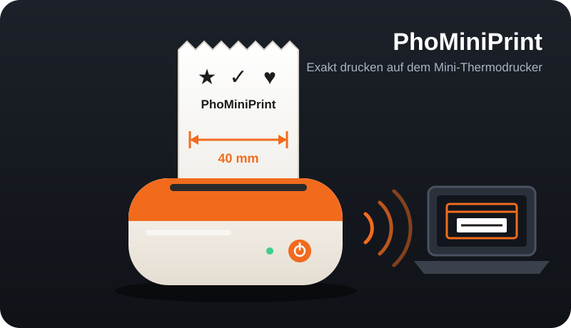

<p align="center">
  
</p>

<h1 align="center">
   PhoMiniPrint
</h1>

<p align="center">
  Deutsches Windows-Programm zum Drucken in <b>exakter Größe</b> auf dem Mini-Thermodrucker <b>Phomemo T02</b> über Bluetooth.
</p>

---

## Ziel

- Bilder **millimetergenau** drucken (±1 mm), Seitenverhältnis bleibt erhalten
- **Bandansicht**: Bild wird ins Band eingepasst und mit der Maus angepasst
- Drehen um 0°, 90°, 180° und 270°
- Ränder links, rechts, oben und unten einzeln einstellbar
- **Kalibrierung** mit Testseite, Werte werden gespeichert
- **Text mit Symbolen** drucken
- Verbindung über **Bluetooth**, Oberfläche komplett auf **Deutsch**
- Windows 11, Auslieferung als **Installer**, C# mit .NET (WPF)

## Stand

✅ **Version 1.0.0** – alle Meilensteine M0–M8 umgesetzt, Abnahme siehe [docs/ABNAHME.md](docs/ABNAHME.md). Exakter Druck 40 × 40 mm am Gerät bestätigt. Installer: `tools/installer_bauen.ps1`.

```bash
dotnet build PhoMiniPrint.slnx
dotnet test PhoMiniPrint.slnx
```

| Dokument | Inhalt |
|---|---|
| [Anforderungen](docs/REQUIREMENTS.md) | fachlich freigegebene Anforderungen |
| [Funktionales Design](docs/FUNCTIONAL_DESIGN.md) | alle Funktionen im Detail |
| [Prozessabläufe](docs/PROCESS_FLOWS.md) | Abläufe als Diagramme |
| [Architektur](docs/ARCHITECTURE.md) | Komponenten, Maßsystem, T02-Protokoll |
| [Umsetzungsplan](docs/IMPLEMENTATION_PLAN.md) | Meilensteine M0–M8 |
| [Analyse](docs/ANALYSIS_SUMMARY.md) · [Offene Fragen](docs/OPEN_QUESTIONS.md) · [Eingabe](docs/REQUIREMENTS_INPUT.md) · [Entwurf](docs/REQUIREMENTS_DRAFT.md) | Herleitung |

## Installer bauen

Voraussetzungen: .NET 10 SDK und [Inno Setup 6](https://jrsoftware.org/isinfo.php).

```bash
powershell -ExecutionPolicy Bypass -File tools/installer_bauen.ps1
```

Ergebnis: `artefakte/PhoMiniPrint-Setup-<Version>.exe`, mit eingebauter .NET-Laufzeit. Die Versionsnummer steht nur in `Directory.Build.props`. Das Programm-Icon wird mit `tools/icon_erzeugen.ps1` aus `src/PhoMiniPrint.App/Ressourcen/ProgrammIcon.xaml` erzeugt.

## Hintergrund

[TiMini-Print](https://github.com/Dejniel/TiMini-Print) druckt bereits auf dem T02, kann aber nicht in exakter Größe drucken. Es dient als Referenz für das Bluetooth-Druckprotokoll (Apache-2.0).

## Mitarbeit

Branches nur zweistufig `xxx/yyy` (z. B. `feat/bandansicht`), Änderungen per Pull Request nach `main`. Hooks einmal je Klon aktivieren: `tools\git_hooks_einrichten.bat`.

---

<sub>Phomemo ist eine Marke des jeweiligen Inhabers. PhoMiniPrint ist ein unabhängiges Projekt.</sub>
