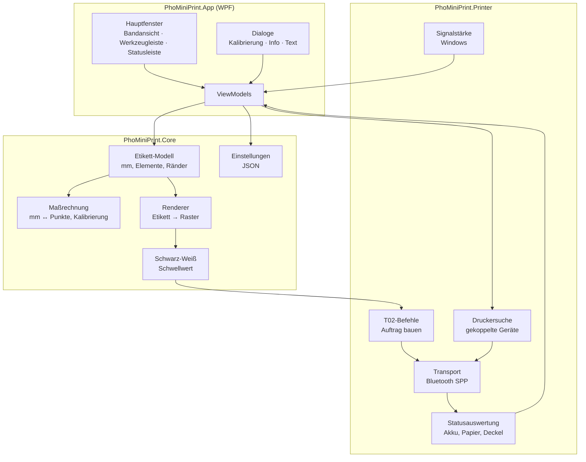

# Architektur – PhoMiniPrint

- **Projektstatus:** TECHNISCHE PLANUNG
- **Bezug:** [REQUIREMENTS.md](REQUIREMENTS.md), [FUNCTIONAL_DESIGN.md](FUNCTIONAL_DESIGN.md), [PROCESS_FLOWS.md](PROCESS_FLOWS.md)

---

## 1. Entscheidungen

### 1.1 Bestätigte Vorgaben (vom Benutzer)

| Nr. | Entscheidung | Quelle |
|---|---|---|
| E-01 | Programmiersprache **C# mit .NET**, Oberfläche **WPF** | NFR-007 |
| E-02 | Läuft auf **Windows 11** | NFR-002 |
| E-03 | Auslieferung als **Installer** | NFR-006 |
| E-04 | Oberfläche komplett **Deutsch** | NFR-001 |
| E-05 | Verbindung über **Bluetooth** zum T02 | FR-002 |
| E-06 | Versionsschema **MAJOR.MINOR.PATCH** | FR-018 |
| E-07 | TiMini-Print als **Referenz** für das Druckprotokoll, Portierung nach C# | INT-002 |

### 1.2 Vorschläge der KI (nicht freigegeben)

Diese Punkte gelten erst mit „UMSETZUNG FREIGEBEN“ bzw. nach ausdrücklicher Bestätigung.

| Nr. | Vorschlag | Begründung |
|---|---|---|
| V-01 | **.NET 10** (LTS) | auf dem PC bereits installiert (SDK 10.0.402), Langzeitunterstützung |
| V-02 | Verbindung über den **Bluetooth-COM-Port (SPP)** mit `System.IO.Ports` | Der T02 nutzt laut TiMini-Print Bluetooth Classic SPP (`use_spp: true`). Windows stellt dafür bereits COM-Ports bereit (COM9/COM10). Kein Spezial-Treiber nötig. |
| V-03 | Muster **MVVM** mit *CommunityToolkit.Mvvm* | trennt Oberfläche und Logik, gut testbar |
| V-04 | Rendern mit **WPF** (`DrawingVisual`, `RenderTargetBitmap`) | gleiche Grafik-Engine für Bandansicht und Druck → Ansicht = Ausdruck; Windows-Schriften inkl. Ersatzschriften für Symbole und Emojis |
| V-05 | Einstellungen als **JSON** in `%APPDATA%\PhoMiniPrint\einstellungen.json` | lokal, lesbar, einfach |
| V-06 | Installer mit **Inno Setup** (kostenlos) und *self-contained*-Build | keine .NET-Installation beim Benutzer nötig |
| V-07 | Tests mit **xUnit** | Standard für .NET |
| V-08 | **GitHub Actions** baut und testet bei jedem Pull Request | Fehler früh erkennen |
| V-09 | Signalstärke über **Windows.Devices.Enumeration** (Eigenschaft `System.Devices.Aep.SignalStrength`) | einzige bekannte Windows-Schnittstelle dafür; Verfügbarkeit bei Bluetooth Classic unsicher (FR-021) |
| V-10 | Keine Netzwerkzugriffe, keine Update-Prüfung, keine Telemetrie | entspricht Vorschlag NFR-005 |

## 2. Komponenten



### Projekte (Visual-Studio-Lösung `PhoMiniPrint.sln`)

| Projekt | Zuständigkeit | Hängt ab von |
|---|---|---|
| `PhoMiniPrint.App` | WPF-Oberfläche, ViewModels, Dialoge, deutsche Texte | Core, Printer |
| `PhoMiniPrint.Core` | Etikett-Modell, Maßrechnung, Rendern, Schwarz-Weiß, Einstellungen | – (nur WPF-Grafik) |
| `PhoMiniPrint.Printer` | T02-Protokoll, Transport, Status, Druckersuche, Signalstärke | – |
| `PhoMiniPrint.Tests` | Unit-Tests für Core und Printer (ohne echten Drucker) | Core, Printer |
| `tools/T02Probe` | Konsolen-Prototyp für Meilenstein M1 | Printer |

Regel: `Core` und `Printer` kennen die Oberfläche nicht. So sind sie ohne Fenster testbar.

## 3. Maßsystem (Kern für „exakte Größe“)

| Größe | Wert | Quelle |
|---|---|---|
| Auflösung | 203 dpi = **8 Punkte/mm** | TiMini-Print-Profil `phomemo_t02` (`dev_dpi: 203`, `one_length: 8`) |
| Druckbreite | **384 Punkte = 48 mm** | TiMini-Print-Rezept `t02` (`content_width: 384`) |
| Bandhöhe | **50 mm** (gemessen in M1; zuvor 52 mm angenommen) | Benutzer (Q-A2, M1) |
| Länge | unbegrenzt (Rolle) | – |

Umrechnung:

```
Punkte_Länge = runden(mm_Länge × 8 × Faktor_Länge)
Punkte_Höhe  = runden(mm_Höhe  × 8 × Faktor_Höhe)
```

- Das **Etikett-Modell** speichert alles in **mm** (Gleitkomma). Erst der Renderer rechnet in Punkte um.
- Die **Bandansicht** zeigt das Etikett liegend: Länge waagerecht, Höhe senkrecht.
- Der **Drucker** druckt Zeile für Zeile quer zum Band (384 Punkte je Zeile). Der Renderer erzeugt deshalb ein Raster mit 384 Punkten Breite und `Punkte_Länge` Zeilen, also um 90° gedreht gegenüber der Ansicht.
- Die 4 mm Unterschied zwischen Bandhöhe (52 mm) und Druckbreite (48 mm) erscheinen in der Bandansicht als grauer, nicht bedruckbarer Streifen (je ca. 2 mm). Ob der Druckbereich mittig liegt, prüft der Prototyp.

## 4. Druckprotokoll T02 (Referenz TiMini-Print, Apache-2.0)

Kurzfassung aus der Analyse von TiMini-Print (Familie *Phomemo ESC*, Variante `t02`). **Am Gerät geprüft in M1** – Abweichungen siehe [PROTOTYP_ERGEBNIS.md](PROTOTYP_ERGEBNIS.md) (u. a. Akku = `1F 11 08`, Meldung „Druck fertig“ `1A 0F 0C`, 7 mm Nachlauf).

| Zweck | Befehl (hex) | Hinweis |
|---|---|---|
| Initialisieren | `1B 40` | ESC @ |
| Druckdichte | `1F 11 02 n` | n ∈ {1, 2, 4}; zusammen mit `1F 11 37 c` (c = 100 oder 150) ergeben sich **4 Stufen** |
| Medium | `1F 11 0B` | Endlospapier/Etikett |
| Unkomprimiert | `1F 11 35 00` | |
| Rasterbild | `1D 76 30 00 …` | GS v 0: Breite in Byte, Höhe in Zeilen, dann 1 Bit pro Punkt |
| Vorschub | `1B 64 02` (2×) | nach dem letzten Bild |
| Abfrage Akku | `1F 11 0E` → Antwort `04 xx` | xx = Akku %, A1/A2/A3 = niedrig |
| Abfrage Deckel | `1F 11 12` → `05 xx` | 99 = offen, 98 = zu |
| Abfrage Papier | `1F 11 11` → `06 xx` | 88 = kein Papier |
| Überhitzung | Meldung `03 xx` | A9 = überhitzt |
| Ladezustand | Meldung `35 xx` | 02 = lädt |
| Übertragung | Pakete à **128 Byte**, **20 ms** Pause | Profil `stream` |

Eigene Umsetzung in C#, kein kopierter Python-Code. Die Herkunft der Protokollkenntnis wird in `NOTICE` und im Info-Fenster genannt.

**Bekannte Lücken:**
- **Papierstau** hat keinen eigenen bekannten Code (nur „kein Papier“, „Deckel offen“). → Benutzerentscheidung nach M1.
- **Signalstärke** kommt nicht vom Drucker, sondern von Windows (V-09).
- **Druckdichte** hat 4 Stufen; der Regler 0–100 % wird darauf abgebildet.

## 5. Datenflüsse

1. **Bearbeiten:** Benutzeraktion → ViewModel → Etikett-Modell (mm) → Renderer → Bandansicht (Bildschirm, mit Schwelle aus Regler).
2. **Drucken:** Etikett-Modell → Renderer (Punkte, gedreht) → Schwarz-Weiß → T02-Befehle → Transport (Pakete) → T02.
3. **Status:** T02 → Transport (Empfang) → Statusauswertung → ViewModel → Statusleiste. Windows → Signalstärke → ViewModel.
4. **Einstellungen:** ViewModel ↔ Einstellungen (JSON-Datei).

## 6. Schnittstellen

| Schnittstelle | Technik | Richtung |
|---|---|---|
| Bluetooth zum T02 | SPP über virtuellen COM-Port (`System.IO.Ports.SerialPort`) | beidseitig |
| Gekoppelte Geräte | Windows-Geräteverwaltung (WinRT `DeviceInformation`) | lesen |
| Signalstärke | WinRT `DeviceInformation`, Eigenschaft `System.Devices.Aep.SignalStrength` | lesen |
| Bilddateien | WPF `BitmapDecoder` (PNG, JPG) | lesen |
| Schriften | Windows-Schriften, automatische Ersatzschriften | lesen |
| Einstellungen | JSON-Datei im Benutzerprofil | lesen/schreiben |

## 7. Sicherheit und Datenschutz

- Keine Internetverbindung, keine Telemetrie, keine Update-Prüfung (V-10).
- Es werden nur Dateien gelesen, die der Benutzer auswählt.
- Gespeichert wird nur die Einstellungsdatei; keine Bilder, keine Texte.
- Protokolldatei für Fehler nur lokal unter `%LOCALAPPDATA%\PhoMiniPrint\logs` **[Vorschlag]**, ohne Bildinhalte.
- Der Installer benötigt keine Netzwerkfreigaben.

## 8. Fehlerbehandlung

- Alle Fehler werden in **deutsche Meldungen** mit Ursache und nächstem Schritt übersetzt (NFR-004).
- Druckerzustände (kein Papier, Deckel offen, überhitzt, Akku niedrig) sind **Zustände**, keine Programmfehler.
- Ein abgebrochener Druck wird nicht automatisch wiederholt.
- Unerwartete Ausnahmen werden protokolliert; das Programm bleibt bedienbar.

## 9. Versionierung und Auslieferung

- Eine Stelle für die Versionsnummer: `Directory.Build.props` (`<Version>MAJOR.MINOR.PATCH</Version>`).
- Daraus: Dateieigenschaften der EXE, Info-Fenster, Titelleiste **[Vorschlag]**, Installername `PhoMiniPrint-Setup-<Version>.exe`, Eintrag in „Apps & Features“.
- Versionen `0.x.y` während der Entwicklung, **1.0.0** nach bestandenem Abnahmetest (M8).
- Git-Tag `v<Version>` je Auslieferung **[Vorschlag]**.

## 10. Erweiterungsmöglichkeiten

- Weitere Phomemo-Modelle (M02, M110): eigene Druckbreite und Befehle in `PhoMiniPrint.Printer`, Oberfläche unverändert.
- Weitere Bildformate (BMP, GIF, PDF), Zwischenablage (FR-015, derzeit abgelehnt).
- Vorlagen speichern (FR-014, Vorschlag).
- Rasterung (Dithering) für Fotos als dritte Umwandlungsart.
- QR-Codes und Barcodes als neue Elementart.
