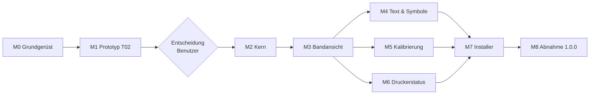

# Umsetzungsplan – PhoMiniPrint

- **Projektstatus:** UMSETZUNG FREIGEGEBEN (2026-11-15) → IMPLEMENTIERUNG
- **Freigabe:** „UMSETZUNG FREIGEBEN“ durch den Benutzer am 2026-11-15. Die Planungsannahmen in Abschnitt 2 gelten damit als Startwerte und bleiben änderbar.
- **Bezug:** [REQUIREMENTS.md](REQUIREMENTS.md), [FUNCTIONAL_DESIGN.md](FUNCTIONAL_DESIGN.md), [ARCHITECTURE.md](ARCHITECTURE.md)

---

## 1. Vorgehen

- Arbeit in **Meilensteinen M0–M8**, jeder auf einem eigenen Branch `xxx/yyy` und mit einem **Pull Request** nach `main`.
- Jeder Meilenstein endet mit: Build grün, Tests grün, kurzer Bericht im PR, Abgleich mit den Akzeptanzkriterien.
- **Abweichungen** von Anforderungen oder Architektur werden im PR dokumentiert und vorher mit dir abgestimmt.
- **Entscheidungspunkt nach M1:** Ergebnisse vom echten T02 werden dir vorgelegt, bevor die Oberfläche gebaut wird.

## 2. Planungsannahmen (Vorschläge, änderbar)

Diese Werte füllen Lücken, die in den Anforderungen bewusst offen geblieben sind. Sie sind **nicht freigegeben**; mit „UMSETZUNG FREIGEBEN“ werden sie als Startwerte verwendet, du kannst sie jederzeit ändern.

| Thema | Annahme |
|---|---|
| Startwerte Ränder | je 2 mm |
| Startwert Länge | 40 mm |
| Startwerte Regler | Stärke für Schwarz 50 %, Druckdichte 50 % (Stufe 3) |
| Abbildung Druckdichte | 0–24 % → 1, 25–49 % → 2, 50–74 % → 3, 75–100 % → 4 |
| Statusabfrage | alle 10 s, nicht während des Drucks |
| Kalibrier-Testseite | Rahmen 80 × 40 mm, Plausibilität ±10 % |
| Text in exakter Größe (Q-C4) | Schriftgröße in pt, Zeichenhöhe in mm wird angezeigt |
| Versionsinfo (Q-D5 a–c) | „Hilfe → Über PhoMiniPrint“, Version in Titelleiste, Build-Datum, Lizenzhinweise |
| Exemplare (Q-D4) | Anzahl einstellbar, Standard 1 |
| Technik | .NET 10, SPP über COM-Port, MVVM, Inno Setup, xUnit, GitHub Actions (siehe ARCHITECTURE.md 1.2) |

## 3. Meilensteine

### Fortschritt

| Meilenstein | Stand |
|---|---|
| M0 Grundgerüst | ✅ umgesetzt (PR `chore/grundgeruest`), CI-Workflow folgt (A-02) |
| M1 Prototyp T02 | ✅ umgesetzt, Ergebnis in [PROTOTYP_ERGEBNIS.md](PROTOTYP_ERGEBNIS.md) – Entscheidungen E-1 bis E-3 getroffen (A, A, A) |
| M2 Kern | ✅ umgesetzt (PR `feat/kern-rendern`), ohne Papier geprüft – 38 Unit-Tests |
| M3 Bandansicht | ✅ umgesetzt (PR `feat/bandansicht`), Oberfläche am Bildschirm geprüft, 48 Unit-Tests; Druck und Animation noch nicht am Gerät (Abnahmedruck nur nach Zustimmung) |
| M4 Text | ✅ umgesetzt (PR `feat/text-symbole`), am Bildschirm geprüft, 56 Unit-Tests; Abnahmetext ohne Papier geprüft (jedes Zeichen gerastert) |
| M5 Kalibrierung | ✅ umgesetzt (PR `feat/kalibrierung`), 71 Unit-Tests; Dialog und Neustart am Bildschirm geprüft; Testseite am Gerät noch nicht gedruckt |
| M6 Druckerstatus | ✅ umgesetzt (PR `feat/druckerstatus`), 82 Unit-Tests; am T02 ohne Druck geprüft: bereit, Akku 60 %, Papier ok, Verbindung 100 % |
| M7 Installer | ✅ umgesetzt (PR `feat/installer`): Info-Fenster, .ico, Inno-Setup-Installer 52,6 MB self-contained; Installation für den Benutzer, Start aus dem Startmenü und Deinstallation geprüft. GitHub-Actions-Artefakt entfällt (A-02, Token ohne `workflow`) |
| M8 Abnahme | ✅ ohne Druck abgenommen (Entscheidung des Benutzers), Protokoll `docs/ABNAHME.md`; Version 1.0.0. Abnahmestreifen mit neuer Rolle nachholen | Papier knapp: Abnahmedruck nur als kurzer Streifen nach Zustimmung |

### Abweichungen vom Plan

| Nr. | Abweichung | Grund |
|---|---|---|
| A-01 | Lösungsdatei heißt `PhoMiniPrint.slnx` statt `.sln` | neues Standardformat des .NET-10-SDK, von Visual Studio 2022/2026 und `dotnet` unterstützt |
| A-02 | GitHub-Actions-Workflow aus M0 herausgenommen, folgt in eigenem PR | Dem GitHub-Token fehlt das Recht `workflow`; Entscheidung des Benutzers 2026-11-15. Build und Tests wurden lokal geprüft. |
| A-03 | `PhoMiniPrint.Core` verweist auf `PhoMiniPrint.Printer` (nutzt `Rasterbild` und die T02-Eckdaten) | vermeidet doppelte Definitionen; `Printer` bleibt ohne Oberfläche und ohne Kern-Abhängigkeit |

### M0 – Grundgerüst · Branch `chore/grundgeruest`
- Lösung `PhoMiniPrint.sln` mit den Projekten App, Core, Printer, Tests.
- `Directory.Build.props` mit Version `0.1.0`, `.gitignore` für .NET, `NOTICE` mit TiMini-Print-Hinweis.
- GitHub-Actions-Workflow: Build und Tests bei jedem PR.
- Leeres WPF-Fenster „PhoMiniPrint 0.1.0“.
- **Fertig, wenn:** `dotnet build` und `dotnet test` laufen lokal und in GitHub Actions grün.

### M1 – Prototyp Druckerkommunikation · Branch `feat/t02-prototyp`
Kleines Konsolenprogramm `tools/T02Probe`, **ohne Oberfläche**. Klärt alle offenen Hardware-Fragen am echten Gerät.

| Test | Prüft | Anforderung |
|---|---|---|
| T1 | Welcher COM-Port (COM9/COM10) gehört zum T02, Verbindung öffnen | FR-002, INT-001 |
| T2 | Akku abfragen (`1F 11 0E`) | FR-020 |
| T3 | Papier und Deckel abfragen, Rolle entnehmen → Meldung? | FR-020 |
| T4 | Testraster 320 × 320 Punkte drucken → **40 × 40 mm?** nachmessen | FR-004, BR-002 |
| T5 | Volle Breite 384 Punkte: wo liegt der Druckbereich auf dem 52-mm-Band? | BR-001 |
| T6 | Druckdichte Stufen 1–4 drucken, Unterschied sichtbar? | FR-007 |
| T7 | Signalstärke über Windows lesbar? Wert ändert sich mit Abstand? | FR-021 |
| T8 | Gibt es eine Meldung bei Papierstau? | FR-020 |

- **Ergebnis:** Bericht `docs/PROTOTYP_ERGEBNIS.md` mit Messwerten.
- **Entscheidungspunkt:** Wenn T2, T3, T6, T7 oder T8 nicht wie gefordert funktionieren, lege ich dir Alternativen vor. Keine Anforderung wird stillschweigend gestrichen.

### M2 – Kern: Maße, Modell, Rendern · Branch `feat/kern-rendern`
- Etikett-Modell in mm, Ränder, Elemente (Bild, Text), Drehung.
- Umrechnung mm → Punkte mit Kalibrierfaktoren.
- Renderer: Etikett → Raster 384 Punkte × Länge, inkl. Drehung auf Laufrichtung.
- Schwarz-Weiß mit Schwellwert.
- T02-Druckauftrag aus Raster (Befehle aus M1).
- **Tests:** z. B. „40 mm → 320 Punkte“, „Rand 2 mm → 16 Punkte“, „Bild maximal einpassen ohne Verzerrung“, „Drehung 90° tauscht Länge und Höhe“, Befehlsfolge stimmt Byte für Byte.

### M3 – Oberfläche: Bandansicht · Branch `feat/bandansicht`
- Hauptfenster: Bandansicht in der Mitte, Einstellungen rechts, Statusleiste unten **[Vorschlag zu Q-D1]**.
- Bild einfügen (PNG/JPG), automatisch maximal einpassen.
- Mit der Maus: Ecken ziehen (Größe), Mitte ziehen (Position).
- Drehen 0/90/180/270°.
- Felder Länge und Ränder (einzeln), Warnung bei Überschreitung.
- Regler Stärke für Schwarz und Druckdichte mit Zahl.
- Drucken-Schaltfläche.
- **Regler-Gestaltung (Wunsch des Benutzers, 2026-11-15):** dicke Spur mit oranger Füllung bis zum Wert, runder Griff, Skala 0/25/50/75/100, großer Zahlenwert; „Stärke für Schwarz“ mit Grauverlauf-Vorschau, „Druckdichte“ mit Anzeige der aktiven Stufe 1–4.
- **FR-022 Druckanimation:** Drucker-Symbol mit animierten Funkwellen vom PC zum Drucker während der Übertragung; Papierstreifen kommt passend zum Fortschritt heraus (WPF-Animation, gesteuert über den Sendefortschritt).
- **Wunsch des Benutzers (2026-11-15, „falls freier Platz ist“):** Drucker-Illustration aus `docs/bilder/drucker.svg` als Startansicht der leeren Bandansicht mit Hinweis „Bild oder Text einfügen“; Programm-Icon aus `docs/bilder/icon.svg` in Titelleiste und Taskleiste.
- **Fertig, wenn:** F-03, F-04, F-05, F-07, F-08 ihre Akzeptanzkriterien erfüllen.
- **Umgesetzt (2026-11-15):** Bandansicht mit mm-Linealen, schraffierten nicht bedruckbaren Streifen, Rändern und Schwarz-Weiß-Vorschau aus demselben Raster wie der Druck; Anfasser an den Ecken, Pfeiltasten (1 mm, mit Umschalt 1/8 mm), Entf; Breite/Höhe exakt per Eingabe; Ziehen einer Datei in die Ansicht; Bild als Startparameter („Öffnen mit“); EXIF-Ausrichtung von Fotos. Drucken sucht den T02, prüft Papier, sendet und wartet auf „Druck fertig“. Ränder und Regler werden erst in M5 gespeichert.

### M4 – Text mit Symbolen · Branch `feat/text-symbole`
- Textdialog mit Schriftart, Größe, fett, Ausrichtung.
- Symbolauswahl, Einfügen an der Cursorposition.
- Text und Bild gemeinsam auf einem Etikett.
- **Fertig, wenn:** Testtext `° ² € § ± ✓ ✗ ★ ♥ → ☎ ⚠ 😀 👍` vollständig gedruckt wird.
- **Umgesetzt (2026-11-15):** Textdialog (Strg+T, Doppelklick zum Bearbeiten) mit Schriftart, Größe in pt und Zeichenhöhe in mm, fett, Ausrichtung, mehrzeilig; Symbolauswahl mit 52 Zeichen und Emojis, Einfügen an der Schreibmarke; Warnung „Das Zeichen ‚…‘ kann nicht gedruckt werden.“ (Prüfung gegen gewählte Schrift und Windows-Ersatzschriften). Text wird gleichmäßig in seinen Kasten skaliert: Ecken ziehen ändert die Schriftgröße, Drehen behält sie. Zu langer Text wird beim Einfügen auf den Druckbereich verkleinert. „Maximal einpassen“ gilt jetzt auch für Text.

### M5 – Kalibrierung und Einstellungen · Branch `feat/kalibrierung`
- Menü „Kalibrierung“: Testseite, Messwerte eingeben, Faktoren speichern, zurücksetzen.
- Einstellungen in `%APPDATA%\PhoMiniPrint\einstellungen.json`: Ränder, Regler, Faktoren, letzter Drucker.
- **Fertig, wenn:** Nach Kalibrierung ±1 mm, nach Neustart alle Werte erhalten.

### M6 – Druckerstatus · Branch `feat/druckerstatus`
- Statusleiste: Verbindung, **Akku % + Balken**, Papier/Deckel, **Signal % + Balken**.
- Regelmäßige Abfrage, sofortige Anzeige von Meldungen.
- Druck sperren bei kein Papier/Deckel offen.
- Umsetzung so, wie nach M1 entschieden.

### M7 – Versionsinfo und Installer · Branch `feat/installer`
- Info-Fenster und Version in der Titelleiste.
- Info-Fenster mit Programm-Icon (Wunsch des Benutzers, 2026-11-15); Icon auch als `.ico` für EXE, Startmenü und Installer.
- Inno-Setup-Skript, self-contained-Build für win-x64.
- `PhoMiniPrint-Setup-<Version>.exe` als Artefakt in GitHub Actions **[Vorschlag]**.
- **Fertig, wenn:** Installation auf Windows 11 ohne vorinstalliertes .NET funktioniert; Startmenü-Eintrag vorhanden.

### M8 – Abnahmetest · Branch `test/abnahme`
- Prüfprotokoll `docs/ABNAHME.md`: jede bestätigte Anforderung mit Akzeptanzkriterium, Ergebnis, Messwert.
- Messungen mit Lineal am echten T02 (40 × 40 mm, Ränder, Kalibrierung).
- Bei Bestehen: Version **1.0.0**, Git-Tag `v1.0.0`.

## 4. Reihenfolge und Abhängigkeiten

## 5. Zuordnung Anforderungen → Meilensteine

| Anforderung | Meilenstein |
|---|---|
| FR-001, FR-002, INT-001, INT-002 | M1, M2 |
| FR-003 | M3, M6 |
| FR-004, FR-005, FR-006, FR-008, FR-016, FR-017, FR-019, BR-001, BR-002 | M2, M3 |
| FR-007 | M2, M3 |
| FR-009, FR-010, FR-013 | M4 |
| FR-012 | M5 |
| FR-018 | M0, M7 |
| FR-020, FR-021 | M1, M6 |
| FR-022 | M3 |
| NFR-001, NFR-004 | alle |
| NFR-002, NFR-006, NFR-007 | M0, M7 |
| NFR-003 | M1, M5, M8 |

## 6. Risiken während der Umsetzung

| Risiko | Gegenmaßnahme |
|---|---|
| R-01/R-02 Maßabweichung | M1 misst, M5 kalibriert |
| R-07 Protokoll-Portierung | M1 vor jeder Oberfläche |
| R-08 Werte nicht verfügbar (Akku, Papierstau, Dichte, Signal) | M1 prüft, Entscheidung durch dich |
| WPF rendert Emojis nur einfarbig | gewollt für Thermodruck; in M4 geprüft |
| COM-Port-Nummer ändert sich | Port wird über den Gerätenamen „T02“ ermittelt, nicht fest eingetragen |

## 7. Was du nach „UMSETZUNG FREIGEBEN“ tun musst

- Bei **M1**: T02 einschalten, Rolle einlegen, Ausdrucke mit dem Lineal messen und mir die Werte nennen; einmal die Rolle entnehmen bzw. den Deckel öffnen.
- Bei jedem Meilenstein: PR ansehen und mergen (oder mich mergen lassen).
- Bei **M8**: Abnahmemessungen bestätigen.
