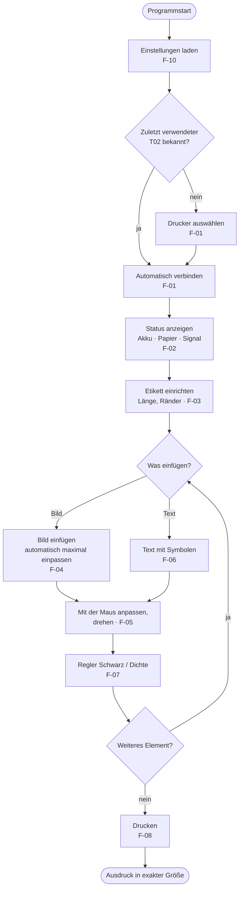
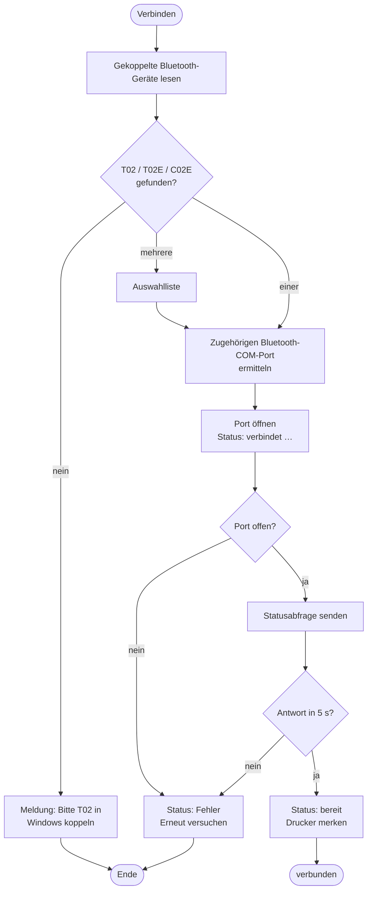
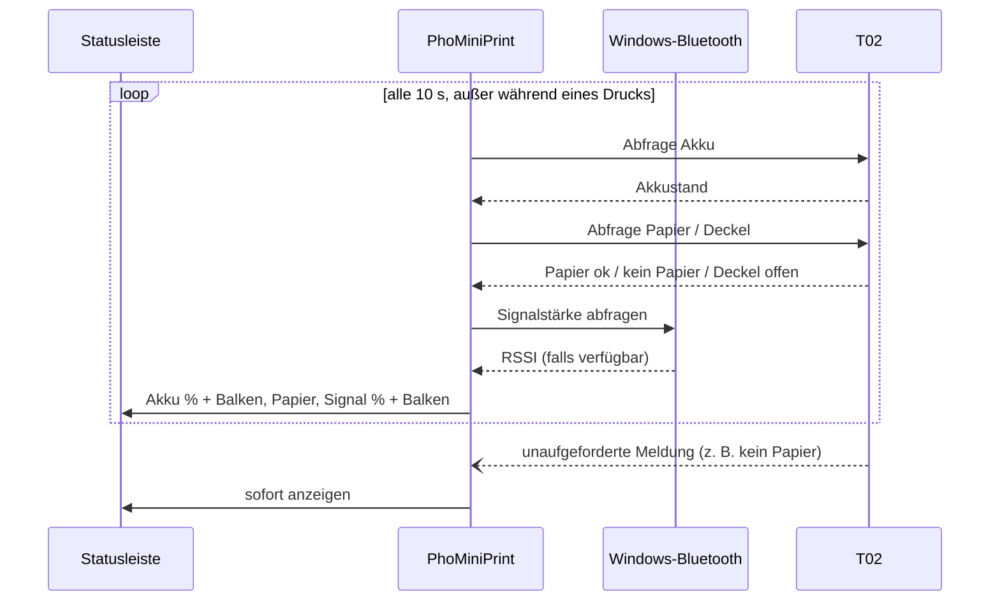
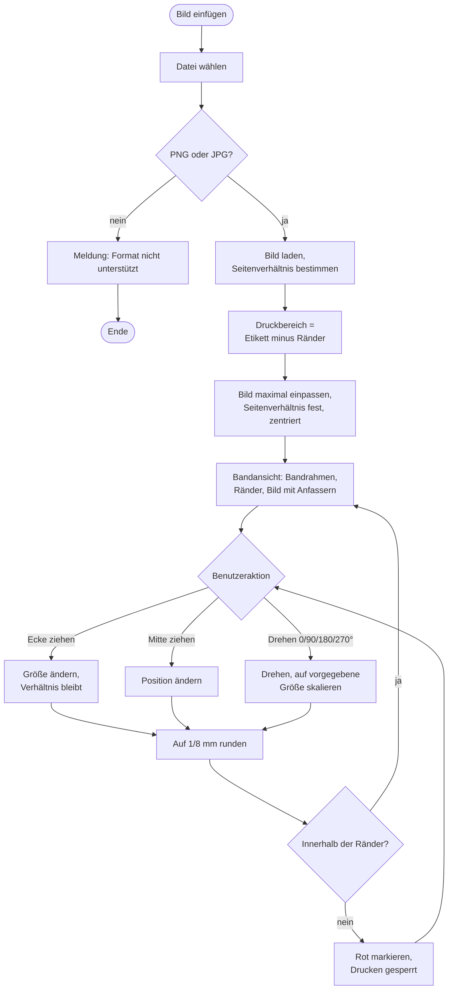
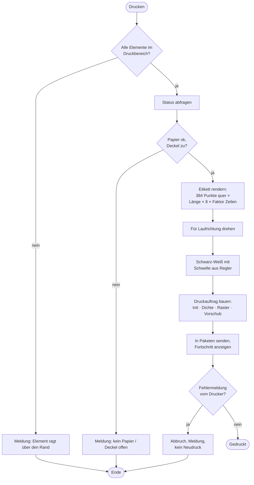
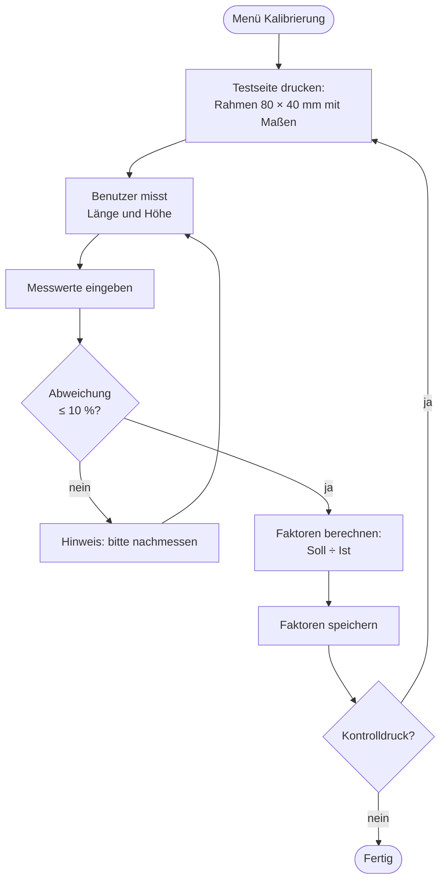
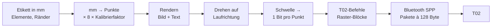

# Prozessabläufe – PhoMiniPrint

- **Projektstatus:** TECHNISCHE PLANUNG
- **Bezug:** [FUNCTIONAL_DESIGN.md](FUNCTIONAL_DESIGN.md) (F-01 … F-12), [REQUIREMENTS.md](REQUIREMENTS.md)

Die Diagramme sind in Mermaid geschrieben und werden auf GitHub direkt angezeigt.

---

## 1. Gesamtablauf

Vom Start bis zum fertigen Ausdruck.

## 2. Drucker verbinden (F-01)

## 3. Statusüberwachung (F-02)

## 4. Bild einfügen und anpassen (F-04, F-05)

## 5. Drucken (F-08)

## 6. Kalibrieren (F-09)

## 7. Datenfluss beim Drucken

Wie aus dem Etikett in Millimetern Druckerpunkte werden.

